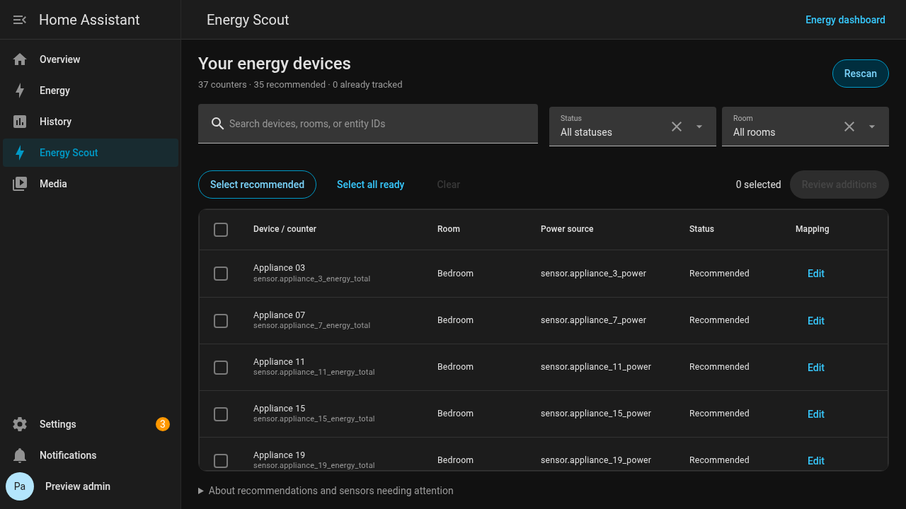

# Energy Scout

Discover existing energy counters and review devices to add to Home Assistant's Energy dashboard.

Energy Scout is a Python custom integration with a bundled sidebar page. It runs inside HA and reuses HA's data table, search, forms, selectors, buttons, and layout components. No additional container, server, cloud account, PHP runtime, access token, or dashboard resource setup is needed. It is independent of Breeze Purifier Card.

**Beta: 0.1.0b2.** Requires Home Assistant **2026.10.4** or newer. Automated compatibility validation currently covers 2026.10.4; newer releases have not yet been verified. Catalog submission: [hacs/default#13140](https://github.com/hacs/default/pull/13140). Until accepted, install it as a custom repository.

## Install

1. In HACS, open **Custom repositories** and add `https://github.com/nemke/ha-energy-scout`, category **Integration**.
2. Download **Energy Scout** and restart Home Assistant.
3. Open **Settings → Devices & services → Add integration → Energy Scout**.
4. Open **Energy Scout** in the HA sidebar. If needed, reload the frontend to show the new entry.

The native **Configure/Options** dialogs remain available as a fallback.

Alternatively, copy `custom_components/energy_scout` into your HA configuration's `custom_components` folder and restart HA.

## Scan → select → review → add



[Phone preview](docs/previews/panel/phone.png) · [Batch review](docs/previews/panel/review.png). Previews show the real HA 2026.10.4 frontend with simulated devices and Recorder metadata.

The sidebar page lists ready counters, already tracked counters, sensors needing attention, power-only devices, and ignored suggestions in one searchable table. Filter by room/status, sort the columns, or rescan. On phones, room and status controls are behind **Show filters**. Tracked devices remain visible for review; the page does not edit existing mappings in place.

For a larger installation:

1. Click **Select recommended** to select proposed counters in the current view together.
2. Use checkboxes to adjust the selection. **Edit** opens HA's native form controls for a display name, same-device power sensor, and upstream device. Draft edits survive HA updates and rescans.
3. Click **Review additions**, then **Add N devices** once for the batch.

Recommendations prefer one lifetime counter per channel, leave ambiguous totals for manual selection, and exclude ready alternatives to a counter already tracked on that channel. Names suggesting grid, production, or battery roles also require manual review. Recommendations are selection hints, not proof of physical meter topology. **Select all ready** is a manual alternative; it can include overlapping counters and is subject to validation.

Changing search or room/status filters clears the selection so hidden rows are never added accidentally. It keeps mapping drafts. Ordinary HA state updates do not overwrite drafts or trigger repeated scans.

Entries are added under **Individual devices** in the built-in Energy configuration. Existing grid, solar, battery, water, tariff settings, and device entries are preserved. A fresh metadata/configuration check happens when you submit. An invalid or stale batch is rejected before writing.

Select suggestions to ignore or restore them in bulk. Select tracked entries owned by Energy Scout to review their removal. Entries added outside the integration are displayed but cannot be removed by it. All panel APIs and the sidebar page require an administrator account.

An accepted configuration does not guarantee immediate graphs: HA may need time to compile new statistics. Energy Scout does not import or backfill historical data.

## Choosing counters

- Prefer a device's cumulative lifetime total over a daily, weekly, or monthly counter when both measure the same consumption.
- Do not add both the total and a period counter for the same channel. Energy Scout flags likely alternatives and rejects selecting both together when they share its channel hint.
- Multi-outlet devices can expose one counter per outlet. Matching names can suggest corresponding power channels, but ambiguous power mappings are left unset for review.
- A device can also expose aggregate, import, export, production, or battery counters. Units and state classes alone cannot prove their role. Review the source before adding it as appliance consumption.
- Set an **upstream device** when one tracked device already includes another's consumption. Energy Scout never guesses these physical relationships.
- Power-only devices need an energy counter first. You can create one with HA's Integration helper or another suitable integration; Energy Scout does not estimate consumption or create helpers in this version.

Eligibility checks include energy device class, HA energy units, cumulative state class (or legacy measurement with a reset), finite nonnegative current readings, Recorder inclusion, and existing sum metadata. Power suggestions require compatible power metadata and mean statistics. Disabled, unavailable, excluded, and not-yet-recorded sources are reported instead of converted to zero.

## Background discovery

Scans run after HA startup, after debounced registry/metadata changes, and every five minutes to pick up Recorder readiness. These are local metadata reads; device refresh rates are untouched. Ordinary numeric updates do not trigger a new scan for every reading.

When enabled, one persistent notification links to the sidebar page when the set of ready candidates changes. Dismissing it does not cause it to reappear on every scan. Ignore individual suggestions to suppress them persistently, or disable discovery notifications. Ignored entity-registry IDs survive entity renames.

**Automatic registration is intentionally deferred.** This release discovers and notifies in the background; users review every addition. There is no unattended addition mode.

## Remove additions

**Remove entries added by Energy Scout** lists only entries in its persistent ownership log. Select entries, then explicitly confirm removal. Sensors and Recorder history remain untouched.

If an entry was edited outside Energy Scout, removal is refused. An upstream entry with remaining dependents is also protected. Manage such entries in HA's Energy settings. Unloading or uninstalling Energy Scout leaves configured Energy entries in place.

This is selective removal of recorded additions, not a global snapshot rollback. The ownership log is stored separately from HA's Energy preferences; an interrupted write may leave a successfully added entry that must be managed in HA's own Energy settings.

## Development

Python 3.14 is required for the pinned HA runtime:

```sh
python3.14 -m venv .venv
.venv/bin/pip install -r requirements_test.txt
.venv/bin/ruff check custom_components tests
.venv/bin/ruff format --check custom_components tests
.venv/bin/pytest -q
```

Tests exercise discovery rules, actual HA configuration flows, the actual Energy preferences manager and storage, merges, stale reviews, exclusions, notifications, and guarded removal. Device and Recorder metadata fixtures are simulated; validation on a real HA installation remains necessary before a stable release.

The sidebar asset is included inside the integration; users do not install Node or copy JavaScript resources. Frontend development requires Node 24/npm 11:

```sh
npm ci
SCOUT_PYTHON=.venv/bin/python npm test
```

The browser suite starts a disposable HA instance on localhost:8814 with simulated metering data and exercises the actual HA frontend components. It does not connect to the user's HA.

The internal Energy preferences API is isolated in `energy.py` and tested against HA 2026.10.4. Energy Scout does not edit `.storage/energy` directly. See [implementation notes](docs/ARCHITECTURE.md).

MIT license.
